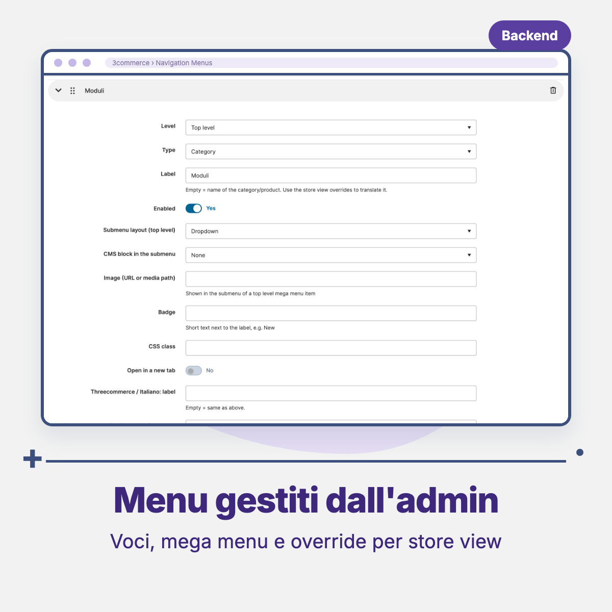

# Threecommerce_Menu: navigation menus per store view for Magento 2 / Mage-OS

Navigation menus managed from the admin for Magento 2 and Mage-OS, with a **different menu for each store view**: dropdowns, **mega menu** with CMS blocks, and per-store-view labels and links.

**Compatibility:** Magento Open Source / Adobe Commerce 2.4.4 – 2.4.9 · Mage-OS 1.x / 3.x · PHP 8.1 – 8.4 · Themes: Luma, Breeze, Hyvä
**License:** commercial · coming soon

## Features

- Grid and form under **3commerce → Navigation Menus**.
- **One menu per store view**: several menus can share the same identifier if assigned to different store views; the storefront shows the one of the current store view, and a menu assigned to "All store views" is the default.
- **Per-store-view items**: each item can override label, URL/reference and visibility for a store view (empty = same as the main item), so you translate or hide an item without duplicating the menu.
- Item types: category, CMS page, product (SKU), free URL, text only.
- Up to 4 levels, drag and drop ordering, items can be disabled.
- **Automatic subcategories** (1-3 levels) for category items, respecting "Include in menu" and the category status in the store view.
- **Mega menu** for top-level items: columns with the child items plus a CMS block and/or an image on the side; or a simple dropdown.
- Text badge (e.g. "New"), SVG icon before or after the label (file in `pub/media`, sanitized and inlined), extra CSS class, open in a new tab.
- Items pointing to disabled or missing categories, pages or products in the store view are hidden automatically.
- Dedicated cache, cleaned on save and kept in sync with category, page and CMS block caches.
- Markup and CSS of its own, with CSS custom properties; only a small vanilla script for the mobile menu (no jQuery, Alpine or Knockout). A Hyvä template (Tailwind + Alpine) is included.
- Command to import menus from Snowdog Menu (`threecommerce:menu:import-snowdog`); Snowdog data is left untouched.

## Requirements

- Magento Open Source / Adobe Commerce 2.4.4+ or Mage-OS
- PHP 8.1 – 8.4
- Package: `threecommerce/m2-base`

## Availability

This module is not yet available for purchase. See the [product page](https://www.threecommerce.it/menu-navigazione-store-view-magento-2?utm_source=github&utm_medium=readme&utm_campaign=magento2-menu) for its status, or [contact us](https://www.threecommerce.it/contatti?utm_source=github&utm_medium=readme&utm_campaign=magento2-menu) to be notified when it is released or to ask for information.

## Configuration

Menus are created in **3commerce → Navigation Menus**. A menu is shown with a CMS directive, the **Navigation Menu (Threecommerce)** widget, or a layout XML block, passing the menu identifier. Colors and spacing are changed by redefining the module's CSS custom properties in the theme.

## Documentation and support

- Product page: [threecommerce.it/menu-navigazione-store-view-magento-2](https://www.threecommerce.it/menu-navigazione-store-view-magento-2?utm_source=github&utm_medium=readme&utm_campaign=magento2-menu)
- [Changelog](CHANGELOG.md) (in Italian)
- Support and custom development: [threecommerce.it/contatti](https://www.threecommerce.it/contatti?utm_source=github&utm_medium=readme&utm_campaign=magento2-menu)

---

*This repository is the public showcase of the module. The source code is kept in a private repository.*
